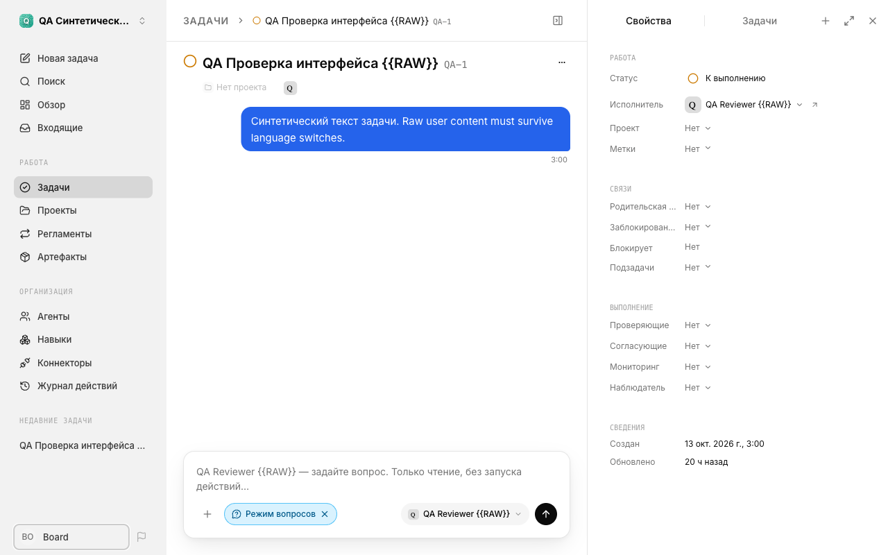
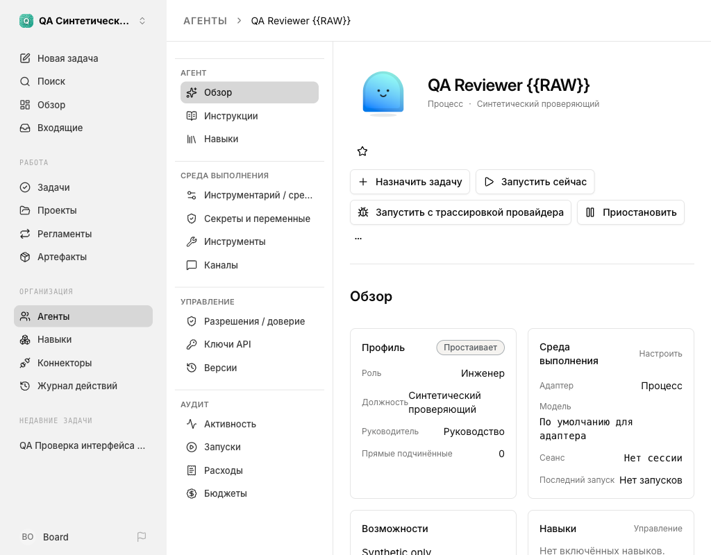

# Stable v2026.10.13.1 — Paperclip v2026.1012.0

Prepared October 13, 2026 for official Paperclip `v2026.1012.0`.
This release targets only the official stable revision below. The maintainer
authorized publication after the release gates. The GitHub release and its
immutable tag identify the published package; this report alone does not deploy
an instance or certify arbitrary Paperclip revisions. Beta is unchanged.

## Exact inputs

- Official stable base: `bba6a45f0d364cfd962ac59b3bdf2426a8222adb`.
- Reviewed integration: `bd71f7afb3eb11c2eb5d4ac0423a08e522edf31a`.
- Integration/result tree: `76bad17ece16021f8070a9d2d6ae8229c2a43c90`.
- Foundation/final patch SHA-256: `ffdde170f9610f12135a9dea0de638ea4ec13d2305e3c683f5c8ea659add0c11`.
- Scope: 965 localization paths; no backend, dependency, lockfile or deployment changes.
- Runtime: `pinned-en-ru`; 19,302 English and 19,682 Russian messages.
- Public inherited localization: `9cf846bbf6f174d0d394c4faf08c18d77f54bd38`.

The complete integration is reproduced from the public exact base and the included
foundation; a private integration Git object is not needed. No community runtime
overlay or new language is included. Published historical packages remain unchanged.

## Integration and language review

Reviewed newer localization was reused only where the official stable and reference
input blobs/modes matched, or after manually retaining stable-only behavior. Stable
provider choices, access descriptions, model/settings logic and protocol identifiers
remain stable, not beta substitutions. App metadata was regenerated against the
actual 82 stable app slugs: 1,084 fields, 928 exact mapped fields and 156 explicitly
classified brand/protocol/example exceptions.

Independent Russian-only review covered 544 changed Russian strings without the
English source. A separate bilingual review checked 544 pairs and actual call sites.
Three native edits and four contextual corrections were applied, then deterministic
checks repeated. These are agent-assisted reviews, not a claim of human editing.
Thirty-six proven inactive aliases/variants were removed from both catalogs; dynamic
activity/plural keys were not removed based on simple text searches.

Additional regressions cover unchanged Teams manifest permission identifiers,
connection authorization lifecycle across language switches, dynamic byte units,
retry labels, complete work-product accessible labels and download-link names.
The October 7 visible/computed «Скачать файл» / “Download file” contract is preserved.

The full-app browser passes found additional UI issues before publication:
task-date labels, composer removal names, budget decimals, stale list/detail task titles,
parent-task terminology, audit-link labels, and doubled quotes in archive confirmation.
All were corrected with existing reviewed Russian keys. Russian catalog bytes remain
unchanged from the previous reviewed integration. One English template now owns its
quote pair rather than quoting interpolated data; the rendered English message is
unchanged. Independent Russian-only and bilingual/context review found no required
wording corrections. A minimal AgentDetail action-row wrapping override also keeps
longer translated actions reachable; the model-value row wraps instead of clipping.
Handlers, routes and other row defaults are unchanged. The first focused source run
passed 14 files / 200 tests, including all locale suites. The last bounded correction
passed 4 files / 172 tests and UI typecheck; its task-title regression failed before
the getter-to-string snapshot correction and passed afterwards.

## Verified source checks

Environment: macOS ARM64, Node 24.19.0, pnpm 9.15.4.

| Check | Result |
| --- | --- |
| Full UI suite, final committed source | PASS: 780 files / 9,710 tests, no failures or skips |
| UI typecheck | PASS |
| Production build, committed integration | PASS |
| Locale structure, interpolation and Russian plural rules | PASS |
| UI token gates and localization-only diff scope | PASS |
| Component browser integration | PASS: Chromium, 1280 px and 390 px, light/dark |
| Distribution tests | PASS: 107 tests; one conditional community-runtime fixture skipped |
| Reproducibility and installer round trip | PASS: identical rebuild, all 965 hashes/modes, forward/reverse application, unchanged Git metadata |

The initial full UI run exposed seven failures in five suites. Obsolete upstream
test mocks/expectations were adapted without dropping assertions. An added
title-specific FileCard aria-label was removed to restore the established visible
and accessible download name; regression tests remain in place. The final full run above follows
these corrections and final catalog edits. An invocation using an unsupported
project filter never ran tests; it is not counted as a pass.

The official target lockfile does not fully resolve its own server package manifests.
Dependency installation used an isolated derived lock with lifecycle scripts disabled,
then restored the exact official tracked lockfile. No resolved lock or dependency
change is shipped. Official lock SHA-256:
`e1856797158f7d0bdb728b9d6c6dda3d65ad5f7896e68216883174de508431a7`.
Isolated build lock SHA-256:
`43e32adbf123b97ca225760b86f75033314f0e2a88498f11addf1a4aea657fbd`.

The additional forbidden-token scan did not pass on this machine: its local-username
substring rule also matches ordinary pre-existing source identifiers. Comparing the
pre-fix committed tree with the final diff found the same 830 matches and no newly
introduced match. This is disclosed as an unchanged scanner false positive, not a
passed scan. The design-token, palette and character synchronization gates passed.

## Browser evidence and limits

Actual LocaleSwitcher, RichWorkProductCard, RunRetryDetails, FileCard and
AiConnectionUsagePanel components were tested with synthetic data and real styles.
RU→EN→RU, saved locale after refresh, retained draft/expanded state, 1/2/5/21 plurals,
byte units, decimal formatting, raw titles/URLs/content, and narrow-layout overflow
checks passed. Console had zero errors/warnings. No backend/provider was contacted.

This is scoped component integration, not every authenticated screen or live-provider
end-to-end coverage. The additional full-app checks below extend that scope, not
those backend guarantees. Full-monorepo/native-runner build, Storybook, physical devices,
Firefox/WebKit and screen-reader sessions were not repeated. Existing Vite
large-chunk/dynamic-import warnings and jsdom unimplemented-browser-API notices remain.
Unknown provider diagnostics, user content, agent output and technical identifiers
remain in the source language. Passing tests do not prove an entirely defect-free
application or translation of arbitrary dynamic content.

### Additional full-app browser verification

Actual compiled UI was served only on loopback with a synthetic API and a dedicated
Chromium session. The broad baseline covered dashboard/navigation, task list/detail,
agent list/overview, general settings, draft form/dialog enablement, archive dialog
cancellation, onboarding's first name/Next step, and 404 recovery. Findings were
corrected and the affected paths rechecked; this is staged baseline plus focused
post-fix verification, not a claim to have repeated every screen after each build.

The final committed build's `ui/dist/index.html` SHA-256 is
`fc3fe80b649e33ea6c1a2866d28d99486677c51dd4d881180470c9d03513bce1`.
The final task-title check used real menu-driven RU→EN→RU on direct entry. Titles
and accessible names changed while synthetic task text and literal braces were
preserved. Date labels, budget decimals, parent-task wording, audit links and archive
quote pairs were verified. Agent action bounds and center hit-tests covered English
and Russian at 1280, 1024 and 390 pixels; the Russian model value now wraps within
its narrow card. Action menus opened and closed without invoking actions.

Completed scenarios had zero console errors; the harness intentionally blocked service
workers and logged that warning. Network access was restricted to loopback. The only
automatic mutation requests were synthetic task-read markers; no task submission,
settings save/archive, agent run/pause/reset/termination or provider call was made.
Some unused informational API endpoints returned empty synthetic lists. Consequently
these checks do not prove authentication, real backend contracts, persistence,
connector/provider operation or complete onboarding. Initial incomplete fixture
responses and an invalid fixture mode were corrected and excluded from final evidence.

The screenshots below contain only synthetic data. English text inside task content,
names and capability descriptions is deliberately preserved as user data.

Publication requires exact-head package CI and published-asset verification in
addition to the recorded local results. Applying this source patch never deploys an instance.
The skipped distribution test concerns the separate `community-json` overlay;
this release's `pinned-en-ru` path was exercised by the exact installer round trip.
