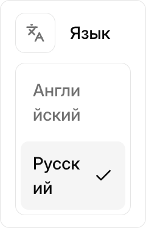

# Beta candidate v2026.11.16.1-beta.1

Prepared November 16, 2026. This is an unpublished maintenance candidate on
[PR #13](https://github.com/DrMaks22/paperclip-localizations/pull/13). Publication
requires separate owner approval, a new immutable tag, prerelease status, and no
Latest flag. No running instance was modified.

## Основа и изменения / Base and scope

Локализация обновлена до проверенного снимка master
`94cb7ad3596e0a73ee6c2ba3276efb12a7139a72`. С предыдущей основой кандидата её
разделяют 1 020 коммитов upstream. Переведены новые экраны, параметры подключений
и секретов, очереди задач, решения, восстановление работы, настройки агентов,
сред и рабочих областей. Сохранены вертикальный переключатель и новые функции
Paperclip. Денежные показатели используют центы, как в обновлённом upstream;
смена языка не меняет исходные значения, имена и состояние фильтров.

Это пакет beta для одного точного коммита. Последний официальный stable,
проверенный при этом запуске, — Paperclip `v2026.1106.0` на коммите
`d69631b01b9c658f80bf8bed389863dce82643e1`. Его отдельный кандидат находится в
[PR #14](https://github.com/DrMaks22/paperclip-localizations/pull/14), не изменён
этим обновлением и ещё не опубликован. Опубликованный stable в индексе каналов
сохранён; master не выдаётся за стабильную версию.

The patch contains UI localization and the three approved locale tools only.
It preserves canonical retry labels, connection-tool discriminators, event IDs,
API payloads, user content, prompts, raw diagnostics and upstream data contracts.
Dependencies, lockfiles, server, database and deployment settings are unchanged.

| Artifact | Value |
| --- | --- |
| Upstream master snapshot | `94cb7ad3596e0a73ee6c2ba3276efb12a7139a72` |
| Public inherited localization | `9dc3e5f7773ff6988f995c6c18e7c76bb029f66f` |
| Reviewed local integration | `ab923a929524df14446232eb2342c7e4506c8222` |
| Integration tree | `43b7c6e73ea0098c729a7333cda072546af7633e` |
| Foundation SHA-256 | `3ec86ded2cb383b47e5d7dafcff2478b79403a82b8d2aa20c81f2eb10501b965` |
| Complete patch SHA-256 | `5758974be0969534f5a00cd10450d5fb1e192349428e7c7620c26c47b8dd9c72` |
| Foundation / complete patch | 1,262 / 1,263 changed paths |
| English / Russian catalog | 24,960 / 25,430 strings |
| Runtime profile | `community-json` |

Compared with the preceding PR #13 head `89de5108`, the catalogs add 1,158 English
and 1,194 Russian entries. Existing key values are unchanged and no entries are
removed; changed source wording uses new keys. Historical unused entries remain.
Russian totals include additional CLDR forms and are not a coverage percentage.

The complete integration reproduces from the public pinned upstream commit and
the checked-in foundation. The local integration commit records provenance; a
consumer does not need that private Git object. Two overlay guards were reviewed
against the changed implementations before updating their exact source hashes:
task-chat display (the new known queue label) and attention display (cent-based
budget formatting and new inline action kinds). Other guards remain unchanged.

## Language review

Independent agent roles handled implementation, Russian-only editing, bilingual
accuracy, and installer review. These are agent reviews, not human sign-off.

The native-language reviewer read 520 initial Russian values without the English
source, followed by 697 values and small metadata/event/queue supplements. The
bilingual reviewer checked 559 initial pairs, 65 reused mappings and one
source-context exception, followed by every pair in a 665-entry final batch and
four related assembled-context corrections. These review counts overlap; they
are not unique catalog counts. Suggestions were applied before final structural
validation and the complete UI-focused test run.

Corrections include permission scope, cancellation versus failure, inclusive age
thresholds, distinctions between environment allocation and run ownership,
gender-neutral actor receipts, grammatical templates around arbitrary task/user
names, exact navigation labels, and the restricted meaning of retry refusals.
Protected product names, permission identifiers and unknown provider messages
remain untouched. Plurals, interpolation, numbered markup and EN/RU parity were
checked again after the language edits.

No additional language is shipped or declared ready. Structural checks and
catalog counts do not prove translation of every possible dynamic screen.

## Verification of the final candidate

Environment: Node.js 24.19.0 and pnpm 9.15.4. Dependency preparation used the
unchanged frozen lockfile with lifecycle scripts disabled, in disposable local
checkouts. The shared/plugin SDK build needed by UI verification passed.

| Check | Result and scope |
| --- | --- |
| Final UI-focused suite, `pnpm exec vitest run ui/ --maxWorkers 4` from the source root | **1,125 files passed; 15,318 tests passed; 1 existing upstream skip; 0 failures** |
| Source UI typecheck and production build | Passed |
| Installed generated artifact: UI typecheck and production build | Passed |
| Token gates, `pnpm check:token-gates` | Passed |
| Toolkit with `PAPERCLIP_REVIEWED_SOURCE` set to the reviewed integration | **148/148 passed, no skips** |
| Actual installed community-runtime and locale-sync tests | **16/16 passed** |
| Temporary synthetic third-locale fixture | **16/16 passed**; no extra language shipped or certified |
| Final EN/RU catalog structure | Passed |
| Reproducible build | Byte-for-byte patch and manifest match |
| Offline forward check and apply | Passed at the exact base |
| Reverse check and apply | Passed; all 1,263 file hashes/modes verified and original Git metadata preserved |
| Read-only release preparation check | Channel/lock/manifest agree; pinned beta base is an ancestor of upstream master |

The skipped UI test is `historical legacy system status keeps a failed MCP start
on a historical settled run while hiding other notices` in
`ui/src/components/TaskChatThread.test.tsx`. It remains an upstream skip and is
not counted as a pass. The UI-focused suite is not the complete backend suite.

Build warnings remain: future Vite native-config compatibility, simultaneous
esbuild/oxc options, four CSS `::highlight` warnings, a mixed static/dynamic
MarkdownEditor import, and large chunks. They were not suppressed. Test output
also includes expected simulated-environment navigation notices.

Two raw checks do **not** report success:

- Generic Russian quality lint exits **1** with **741 heuristic warnings**:
  411 noun forms of «данные» and 330 retained title-case names. The 15 warnings
  affecting new values were reviewed as contextually valid noun forms/protected
  product names; no confirmed defect remains in that delta. Historical warnings
  retain their previous disposition. This is not a claim that the raw linter
  passed.
- Upstream `pnpm check:tokens` exits **1** because its machine-specific privacy
  scan treats the local three-letter username as a case-insensitive substring in
  tracked code. It reports 1,346 matching lines in the localized source and
  1,306 in the pristine official base, including identifiers such as `LabelMap`,
  `InstallManifest` and `emailMatches`. No `/Users/` path was found in those
  reported lines. The baseline failure was reproduced; neither environment nor
  checker was changed to conceal it. This is a limited false-positive diagnosis,
  not a security certification or a passing privacy-gate claim.

## Installer and exporter review

The end-user installer remains offline, opt-in, exact-version-pinned and
reversible. It rejects dirty/partial trees, unsupported revisions, repeat
application, path escapes, symlink/hardlink hazards and edits before reversal.
The real final artifact passed the complete round trip, beyond synthetic tests.

Independent review reproduced a pre-existing unsafe write in the maintainer's
foundation exporter: linked output paths could overwrite a file outside the
package. The exporter now preflights all destinations and ancestors, opens
without truncation using `O_NOFOLLOW` / `O_EXCL`, checks file identity and single
link count, and rechecks all destinations before the first write. **29 regression
tests** cover valid create/replace behavior and linked/directory outputs,
including actual CLI refusal while preserving an external sentinel. The user
installer is unchanged by this helper fix.

The exporter assumes an idle disposable checkout. It is not a multi-file
transaction against disk failure, process termination or concurrent hostile
filesystem mutation. No broader guarantee is claimed.

## Browser verification

The actual installed patch passed **34 checks** in isolated headless Chrome,
using production-built real components and synthetic public data.
[Structured observations](v2026.11.16.1-beta.1/browser.json) include eight selector
measurements, source/patch identifiers and screenshot hashes.

- The vertical selector fits a 240 px container at 320 and 1,280 px viewports,
  in EN and RU, with 100% and 200% root font size. Buttons are 44 px high normally
  and 112 px with enlarged text; names wrap without horizontal overflow. This is
  text resizing, not browser zoom certification.
- Focus, Tab, Enter and Space select the expected language; selected state,
  document language/direction and saved locale survive reload.
- Agent queue labels and position, Circleback metadata and cent-based budget
  formatting change with the locale. The authored agent name remains unchanged.
  12,345 cents displays as $123.45 in English and 123,45 $ in Russian.
- A draft and canonical connection filter survive EN↔RU changes. The native
  filter label translates while its stored `local` value remains unchanged.
  Escape closes the filter popover. Filter-popover coverage is limited to the
  1,280 px / 100% text scenario; only the selector uses the complete matrix.
- No browser console messages, external requests or API requests were observed.
  Only locale persistence was tested across reload; draft/filter persistence is
  asserted across language changes, not reload.

[Russian component fixture](v2026.11.16.1-beta.1/components-ru-1280.png) shows the
reviewed scenario, not a user deployment. The fixture heading, draft label,
authored text and diagnostic state outputs are intentionally outside translation.

## Initial failures and limitations

Initial integration runs exposed canonical retry-label changes, a connection-tool
discriminator incorrectly depending on translated text, a missing locale
subscription, incomplete connector/event/queue labels, and stale upstream-copy
test expectations. These were corrected while retaining raw protocol values and
new upstream behavior. The final full UI-focused suite was rerun after the last
reviewed edits. Browser verification initially used a visibility assertion on a
native select option; it was corrected to assert its label and selected value,
then both browser phases were rerun successfully. No test timeout was raised and
no assertion was removed to disguise an application failure.

No full backend/monorepo suite, live provider authorization, production database,
complete-app navigation or deployed-instance E2E test is claimed. Raw logs,
agent responses and user content retain their source language. Published assets
and release metadata cannot be verified before publication. CI results for the
exact package head are linked separately in PR #13; optional local source
fixtures are not available in CI and their skip must remain explicit.

Existing tags, assets, stable payload and historical reports remain immutable.
[Upstream PR #12989](https://github.com/paperclipai/paperclip/pull/12989) remains
open and conflicted; this scheduled update does not modify its source branch or
claim to resolve its separate backend-CI failure. The maintenance tracking issue
is [#1](https://github.com/DrMaks22/paperclip-localizations/issues/1).
