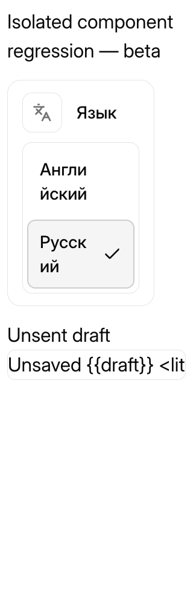

# Beta candidate v2026.11.9.1-beta.1

Prepared November 9, 2026. This is an unpublished maintenance candidate, not a
release or a production deployment. Publication requires separate owner approval,
a new immutable tag, prerelease status, and no Latest flag.

## Основа и изменения / Base and scope

Кандидат обновляет локализацию до точного снимка master
`9046884811a7b06131ec60ce9c9f0255c8e84465`. Добавлены и проверены подписи новых
экранов, регламентов, подключений, рабочих областей, состояния задач и событий.
Сообщения об ошибках, лимиты провайдеров и показатели контекста обновляются при
переключении языка. Вертикальный переключатель сохранён. Это отдельный пакет
beta; он не подходит к официальной stable-версии.

The integration preserves the selected upstream base's functionality. Display
translations use known messages and finite presentation mappings; raw provider
diagnostics, user content, prompts, event identifiers, routes and API payloads
retain their canonical values. There are no changes outside `ui/` and the three
approved locale tools. Dependencies, lockfiles, server, database and deployment
configuration are not included in the patch.

- Exact upstream base: `9046884811a7b06131ec60ce9c9f0255c8e84465`.
- Public inherited localization: `9dc3e5f7773ff6988f995c6c18e7c76bb029f66f`.
- Reviewed local integration: `a9e13cc20e565768074baae03f08a516deaa8397`.
- Integration tree: `21fb8eaab82a1eb29740384a9ced8ee21073b550`.
- Foundation SHA-256: `f92f66262e0a8eb99bf8639a6a6862ad2dbe0a9c05c25e10c6b7ecd9ab2e06c1`.
- Complete patch SHA-256: `d435f68cda688550d3ea80a6981852c52a0c26b12fbabd4e55b5bc783621877e`.
- Foundation: 1,215 paths; generated community-runtime patch: 1,216 paths.
- English: 23,802 strings; Russian: 24,236, including Russian plural forms.

The complete artifact reproduces from the public upstream base plus the checked-in
foundation. The local integration commit is provenance, not a required public
Git object. `community-json` is retained. Only the reviewed task-chat-display
overlay guard and its explanation changed; other guarded sources still match.
No new language catalog or claim of additional-language readiness is included.

## Language review

Independent agent reviews were separated by purpose. The Russian-only reviewer
read 2,404 entries and a further 102-entry supplement across the two channels,
without English source text. The bilingual reviewer read 844 initial beta pairs,
20 shared wording changes and the supplementary source-context decisions.
Counts overlap and are not a count of unique final strings. The final beta delta
contains 878 records, including reused wording corrections. Accepted corrections
were applied only where the English source matched, followed by catalog and
placeholder/plural/markup checks. These are agent reviews, not human sign-off.

Reuse from earlier reviewed translations is documented separately from new
semantic review. External Grok Bot scenarios retain their own terminology;
ordinary Paperclip routines use «регламенты». Canonical diagnostic text is kept
separate from its translated presentation. Structural parity does not certify
that every possible dynamic screen is translated.

## Local verification

- Node.js 24.19.0; pnpm 9.15.4; dependencies prepared from the unchanged frozen
  lockfile with lifecycle scripts disabled.
- Full source UI suite: **1,030 files; 14,120 passed, 0 failed, 1 skipped**.
  The skipped upstream test is `historical legacy system status keeps a failed
  MCP start on a historical settled run while hiding other notices` in
  `ui/src/components/TaskChatThread.test.tsx`; it was not enabled for localization.
- Final post-review regressions: **13 files, 147 tests passed**. The last copy
  refinements were covered after the full-suite run.
- Source UI typecheck, production build and token gates pass.
- Toolkit with the optional reviewed-source fixture: **119/119 passed**.
- Both catalogs pass final deterministic validation.
- The read-only GitHub preparation gate confirms that this pinned base is an
  ancestor of current master and that manifest, source-lock and selected channel
  agree. This does not verify a published release, which does not yet exist.
- The generated patch was checked and applied through the offline installer to
  a separate checkout at the exact base. Its community-runtime and locale-sync
  tests pass **16/16**.
- The installed generated patch passes UI typecheck, production build and token
  gates. Build warnings remain visible: future Vite native-config compatibility,
  simultaneous esbuild/oxc options, four upstream CSS `::highlight` warnings and
  chunks above the size threshold. None caused a failed build.
- Reproducibility and the full installer round trip pass: all 1,216 after-file
  hashes/modes match, reverse application restores a clean exact base, and Git
  metadata is unchanged. An independent installer review found no new blocker;
  nine additional negative/round-trip fixture tests pass.
- The three-locale fixture passes **16/16** with a temporary synthetic Arabic
  catalog, including direction, fallback and exclusion of an incomplete French
  scaffold. Its initial run exposed a missing `context-tokens.ts` fixture input;
  the explicit copy list now includes that newly imported helper. No synthetic
  catalog is shipped or claimed as a translation.
- Generic Russian quality lint exits **1**, reporting **743 heuristic warnings**:
  404 for forms of «данные» and 339 for retained title-case names. The 24 warnings
  on new or changed catalog values were reviewed with no confirmed defect;
  unchanged warnings retain the prior report's disposition. This is not a claim
  that the raw linter passed. Structural validation is a separate passing gate.

## Browser verification

The installed artifact passed **45 checks** in isolated headless Chrome using
production-built real components with synthetic public data and simulated
callbacks. No external/API request or browser console error occurred.
[Structured evidence](v2026.11.9.1-beta.1/browser.json) records source and patch
hashes, observations and scope.

At 320 and 1,280 px viewports, the vertical selector fits at 100% and 200% root
font size. At 320 px, buttons are 44 px high normally and grow to 112 px with
enlarged text; labels do not overflow horizontally. This is text resizing, not
browser zoom certification. Keyboard focus, Enter/Space selection, EN↔RU round
trips and persistence after reload pass.

RoutinesToolbar and GitHubConnectionRecovery labels update without clearing
search/form drafts or invoking connection callbacks. ContextUsageCard token
labels, AgentRateLimitPanel windows and MarkdownUrlLink titles update while raw
provider/model names and URL values remain unchanged. Native tooltip text was
checked through its title attribute, not an OS tooltip screenshot.

[Russian component fixture](v2026.11.9.1-beta.1/beta-components-ru.png) shows the
reviewed synthetic-data scenario; it is not a screenshot of a user's instance.

Initial integration runs exposed untranslated copy and stale test fixtures after
upstream UI changes. Those failures were corrected and the full UI suite rerun;
they are not omitted or counted as successful runs.

## Limits and publication gates

No full backend/monorepo suite, live provider authorization, production database,
or deployed-instance end-to-end test is claimed. User content, model responses
and raw logs are not translated. Focused browser coverage cannot certify every
page, browser or additional language. Published archives and download integrity
cannot be verified before publication. Existing tags, release assets and
verification reports remain unchanged. Upstream PR #12989 remains open and
conflicted; this scheduled update does not modify its branch.
